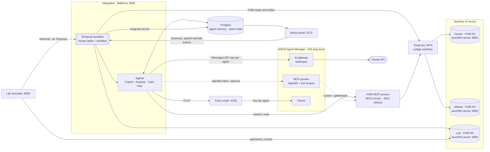

# EHR + Lab agentic integration

A longevity physician's journey that connects EHR history with lab biomarkers to catch risk early, built on
WSO2 integration technology:

- **Ballerina** services, with the official FHIR connector talking to two EHRs (standing in for **Oracle Health / Cerner** and **athenahealth**) and a reference lab (standing in for **Quest Diagnostics**)
- one durable **Temporal workflow** per assessment (`ballerina/workflow`), whose waits on people are real **human tasks**
- **three Claude agents**, with read-only EHR access through the **WSO2 FHIR MCP server** and literature search through a **PubMed MCP server** (Ballerina, NCBI E-utilities)
- a **React portal**: a home page with the flow, and three apps that each open in their own tab — physician workspace (patient summary, EHR explorer, lab order, AI results analysis and release), patient app, and lab console (with the presenter's failure switches)
- realistic patient records generated with **Synthea**, with a curated storyline for the demo personas
- **WSO2 Agent Manager** governing the agents: an **AgentID** and **roles** per agent deciding which MCP tools it may call, Claude through the **AI gateway** with a key per agent and a **PHI-redaction guardrail**, every run **traced**, and **evaluation monitors** with built-in and custom evaluators — see [docs/agent-manager.md](docs/agent-manager.md)

The integration is the layer between the systems of record and the customer's own dashboards. It produces
the **Longevity Record**, the JSON that the physician and patient dashboards read.



## Run it

Everything runs in one **colima** VM: the demo's containers and the Agent Manager cluster. You need colima,
docker and docker-compose (`brew install colima docker docker-compose`) and an Anthropic API key.

```bash
cp secrets.example.toml secrets.toml        # then put your anthropicApiKey in it
./scripts/up.sh                              # creates the VM, builds, starts; first run loads seed/snapshot
./scripts/amp-install.sh                     # WSO2 Agent Manager 1.0.0 on k3d (~15–20 min, once)
./scripts/amp-gateway.sh                     # custom gateway with the mcp-fhir-deidentify policy (once)
./scripts/amp-setup.sh                       # agents, AgentIDs, roles, MCP proxies (tunnel, FHIR policy), model
                                             # configs + budgets per agent, traces
./scripts/amp-guardrails.sh --verify         # PHI redaction on the AI gateway, and proof of what Claude sees
./scripts/amp-evaluations.sh --backfill 24   # custom evaluators + a monitor per agent
```

`./scripts/up.sh --with-amp` does all of it. How it works and how to demo it: [docs/agent-manager.md](docs/agent-manager.md). Later runs of `up.sh` keep whatever data the demo has.

| URL | What |
|---|---|
| http://localhost:5173 | Demo portal home: the flow; opens the physician workspace, patient app and lab console in new tabs |
| http://localhost:8233 | Temporal UI: every assessment as a durable workflow |
| http://console.amp.localhost:8080 | WSO2 Agent Manager console (admin / admin) → project *Longevity Clinic* |
| http://localhost:9090/api/system | Integration API |
| http://localhost:8081/fhir/r4 · :8083 · :8082 | Cerner, Athena and lab FHIR servers |
| http://localhost:8474/proxies | Toxiproxy (what the outage switches change) |
| http://localhost:4318 | Trace router: traces forwarded per agent |

| Script | What |
|---|---|
| `./scripts/up.sh [--restore\|--clean]` | Start. `--restore` reloads the saved demo state, `--clean` only the seed patients |
| `./scripts/snapshot.sh` | Save the current state as the seed (`seed/snapshot/`, checked for API keys) |
| `./scripts/reset.sh` | Clean slate: seed patients only, no assessments |
| `./scripts/smoke-test.sh [ehr] [patientId]` | One full assessment through the API (default Athena, Sofia Alvarez; real model calls) |
| `./scripts/colima-up.sh` | Start the VM (profile `agent-manager`, 6 CPU / 14 GB, vz + rosetta) |

## The journey

| # | Step | Who | Workflow |
|---|---|---|---|
| 1 | Pick the EHR, open the patient: **International Patient Summary** (allergy banner, problems, medications incl. patient-reported, vitals with trends, results, immunizations, procedures, social and family history, rule-based flags, care gaps), past assessments, **EHR explorer** | Physician | — |
| 2 | Start the assessment: record pulled from the patient's EHR, visit opened there | Integration | activities |
| 3 | Explore the record (data types, date range, text, abnormal only), order labs from the lab catalog (the AI evaluation is hidden in the portal: `SHOW_AI_EVALUATION` in `EvaluationPanel.tsx`) | Physician | ⏸ **human task** (physician) |
| 4 | Order of record in the EHR, patient matched in the lab by MRN, order to the lab, **patient notified** (FHIR `Communication`) | Integration | activities |
| 5 | Patient sees "visit the lab" with preparation instructions; lab console → **Collect specimen** | Patient → Lab | ⏸ **human task** (patient; completed by the lab) |
| 6 | Lab processes; lab console → **Release results** (webhook; fallback poller) | Lab | ⏸ system event |
| 7 | Results filed in the EHR → **Results Analysis** → **Care Plan** → draft note in the EHR (preliminary) — unattended | Agents | activities |
| 8 | Physician reviews and **releases**: note final, visit closed, report published, patient sees it | Physician | ⏸ **human task** (physician) |

## Demo script (about 15 minutes)

1. **Physician → Athena → Sofia Alvarez.** The patient summary is built live from athenahealth over FHIR (12 searches in parallel, the EHR has no `$summary`); *View IPS bundle* shows the FHIR document. Point at the red allergy banner (aspirin, angioedema) and the first flag: *NSAID in use despite aspirin allergy* — a deterministic rule, because her ibuprofen is a patient-reported medication.
2. **EHR explorer.** Lab results + medications + notes, last 3 years → the FHIR queries are listed. Read a note ("taking ibuprofen 400 mg two to three times daily").
3. **Start the assessment and order labs.** The assessment starts (Temporal workflow); review the record beside the order form and pick the tests from the lab catalog (e.g. kidney function, metabolic panel, advanced lipids, liver panel).
4. **Temporal UI.** The workflow is suspended on a *human task* for the physician.
5. **Order labs.** Order of record in athenahealth, order to Quest, patient notified. The workflow now waits on the **patient** — open the **patient app** (home page → Patient app, in its own tab): "Action needed: visit Quest Diagnostics", fasting instructions, order number.
6. **Simulate a crash** (lab console → Simulate failures → Crash). The integration restarts in seconds; the workflow is still waiting on the patient.
7. **Lab console → Collect specimen** → waiting on the **lab**. Optionally turn on *Lab webhook down* (lab console) first: the fallback poller completes the task ~20 s later.
8. **Release results.** Results filed in the EHR, then both agents run unattended. The analysis — headline, risk counts, then tabs for overview, risk flags, lab results, care plan, chart note and patient report — confirms early CKD with cystatin C, insulin resistance (HOMA-IR) and a metabolic liver pattern.
9. **Review & release.** The draft note becomes final in athenahealth, the visit closes, the patient app shows the report.
10. **EHR outage** (any assessment, before an EHR write): turn on *athenahealth outage* in the lab console, act (e.g. order labs). The step retries; leave it cut and the assessment pauses with **Retry / Stop** — turn the outage off and click **Retry**: it completes. Turn it off within ~45 s instead and the retry succeeds on its own.

11. **Agent Manager** (console only; the portal no longer shows governance). The console: the Copilot's traces (LLM calls, FHIR and PubMed tool calls, tokens), its monitor's scores, the `anthropic` provider with the PHI guardrail. Full script: [docs/agent-manager.md](docs/agent-manager.md#6-a-ten-minute-demo).

Other personas: **Daniel Reyes** (Cerner) — silent cardiometabolic drift, father's MI at 54, ApoB/Lp(a)/HOMA-IR story; **Priya Nair** (Cerner) — ferritin and hemoglobin falling under treated hypothyroidism, iron deficiency treated in 2019; **Marcus Bell** (Athena) — healthy control.

## How it is built, and why

| Decision | Why |
|---|---|
| **Two EHRs + a lab, each its own FHIR server** | The pitch is "we are the layer between every EHR and the lab". Cerner and Athena hold different patients; every write for an assessment goes back to the patient's own EHR. |
| **Generic `health.clients.fhir` connector, one per EHR** (`ehrSystems` config) | Same pattern as pa-policy-analyzer. Adding an EHR or pointing at a real tenant is configuration: base URL, client credentials, MRN system, MCP URL. |
| **One Temporal workflow per assessment** (`workflow.bal`) | The journey spans minutes (physician) to days (patient, lab). Temporal persists each step, so a waiting assessment survives restarts — the crash switch proves it. |
| **Waits on people are human tasks** (`awaitHumanTask`) | Physician order, patient lab visit and physician release each have an audience (role) and an audit trail of who completed them; the lab's "results ready" is a system event, so it stays a data event. |
| **Retry, then ask a person** (`RetryBeforeReview`) | A system of record down for seconds is retried automatically; down for longer, a review is raised so operations can retry or stop — the assessment does not fail. |
| **Every side effect is an activity** (`activities.bal`) | The workflow function only sequences steps and waits, so Temporal can replay it without calling an EHR, the lab or the model twice. |
| **Idempotent writes** | A retried activity runs again from the top. Encounter, orders, the notification and the note are created once per business identifier; filed results use `ifNoneExist`. |
| **Deterministic patient summary (IPS sections)** (`summary.bal`, `ips.bal`) | The physician must see exactly what the EHR holds. Flags are named rules (drug–allergy cross-reactivity, trends, ranges, family history, BP, BMI, smoking). An IPS FHIR document is composed when the EHR has no `$summary`. |
| **EHR explorer filters in the EHR** (`explorer.bal`) | One FHIR search per data type with the EHR's own date parameters; active problems and medications older than the range are brought in by a second, status-filtered search. |
| **Three agents, not more** (`agents.bal`) | Copilot = reasoning before the order (with the physician, in conversation); Analysis and Care Plan = reasoning after the results. Analysis and Care Plan stay separate although they run back to back: different readers, and the Care Plan agent has no EHR access — it may only use what the analysis established. |
| **Copilot outside the workflow, agents after results inside it** | The Copilot is a conversation (Postgres memory, many turns); only the physician's resulting order is a durable step. Analysis and Care Plan are activities: retries, timeouts, crash recovery. |
| **FHIR MCP server per EHR, read-only** | The Copilot and the Analyst can look up anything the physician did not select, in the patient's own EHR. Only `search`, `read` and `get_capabilities`; EHRs are changed only by activities. |
| **Draft note until released** | The AI-written note is filed as `preliminary`; it becomes `final` and reaches the patient only after the physician's release. |
| **Real failures, not flags** (Toxiproxy) | Outage switches disable a proxy, so the FHIR connector gets real connection errors and the retries, reviews and fallback poller the audience sees are the production code paths. |
| **Workflow view from `ballerina/workflow`'s management API** (`workflow_view.bal`) | Activity tree, human tasks and reviews come from the library; live retry attempts come from Temporal's describe API. |
| **Agent Manager governs, the integration still runs the agents** (`agent_manager.bal`) | The agents stay Temporal activities; Agent Manager adds who they are (AgentID), what they may call (MCP tool scopes) and spend (gateway key per agent), and what they did (traces) — without moving them into its runtime. |
| **Trace router** (`infra/trace-router`) | One process, three agents, one exporter: the router files each agent run under its own agent, and drops non-agent traces (pollers, reads) rather than charging them to an agent. |
| **Synthea + storyline** (`seed/synthea/`) | Synthea gives every patient years of realistic, coded history (SNOMED CT, LOINC, RxNorm, CVX). The storyline overlay fixes the personas' trends, conditions, medications, allergies and notes so the agents find the same story every run. |

## WSO2 Agent Manager

`scripts/amp-install.sh` installs Agent Manager 1.0.0 as the k3d cluster `amp-local` in the same colima VM,
using AMP's own quick-start container (bash 5, k3d, kubectl, helm — nothing to install on the host).
`scripts/amp-setup.sh` then registers project **Longevity Clinic** with three externally hosted agents and
writes what they were issued into a generated block of `secrets.toml` (and `.amp/`, both gitignored):

| Feature | How it is wired |
|---|---|
| **Agent identity** | Each agent has an **AgentID** (OAuth client in the environment's ThunderID). The FHIR and PubMed MCP servers sit behind **MCP proxies** secured by AgentID, a scope per tool group. Roles: `ehr-reader` (FHIR read tools → Copilot, Analyst), `literature-searcher` (PubMed → all three), `ehr-writer` (FHIR writes → nobody). The integration's `McpToolKit` gets its token by client credentials with the proxy as `resource`. |
| **FHIR de-identification** | `mcp-fhir-deidentify`, a custom gateway policy (`gateway/policies/`, built in by `scripts/amp-gateway.sh`), on the FHIR MCP proxies: names, addresses, contact details and identifiers are removed, masked, pseudonymised or generalised in tool results, notes and billing are withheld, and searches by name, birth date or identifier are refused (rules: `amp/fhir-deidentify.json`). |
| **AI gateway** | LLM provider `anthropic` holds the Anthropic key. Each agent has its own model configuration (an LLM proxy with its own URL and key), so usage, limits and guardrails are per agent. |
| **Budgets and cost** | Per-agent US$/day and tokens/hour on each model configuration (`scripts/amp-budgets.sh`, `amp/budgets.json`); over budget the gateway refuses the agent and the workflow step waits for operations to retry. The trace router prices every run with the gateway's price list: spend per agent, assessment and workflow step in the portal. |
| **Monitoring** | `ballerina/ai` emits GenAI spans (`invoke_agent`, `chat`, `execute_tool`); `ballerina/otel` exports them to `infra/trace-router`, which forwards each agent run with that agent's tracing key (Agent Manager attributes a trace by key; one process hosts three agents). |

Without `amp-setup.sh` the agents call Claude and the FHIR MCP servers directly; the portal says so.

**MCP proxies and the tunnel.** Agent Manager 1.0.0 only accepts MCP upstreams that resolve to a public
address, so it cannot reach the FHIR MCP servers on the VM directly. `amp-setup.sh` therefore starts the
`amp-tunnel` compose profile: a Cloudflare quick tunnel (no account) to `infra/mcp-gatekeeper`, an nginx that
rejects every request without the `X-Tunnel-Key` only Agent Manager's proxy sends. The data is synthetic, but
the tunnel URL is public while it runs. `./scripts/amp-setup.sh --skip-mcp-proxies` leaves the agents on
direct MCP access (identity and traces still work).

**Workarounds for Agent Manager 1.0.0** (reported upstream): the host installer needs bash 4+ (macOS has
3.2), so the quick-start container is used; the gateway route caps requests at 30 s, so `amp-setup.sh` raises
it to 300 s for long Claude calls.

## Data

`seed/snapshot/` is the saved demo state — every FHIR store, the integration's database (assessments, agent
memory, longevity records) and Temporal's history — so finished assessments open with their workflow view.
`up.sh` loads it on the first run (`seed/restore-snapshot.sh`); `scripts/snapshot.sh` replaces it. The
images that wrote it are pinned by digest in `docker-compose.yml`.


`seed/cerner/` and `seed/athena/` are committed transaction bundles (one per patient, plus each clinic's
directory), loaded by `seed/seed.sh`. They come from `seed/synthea/generate.sh`:

1. Synthea v4.0.0 (pinned, fixed seeds) generates 40 adults per EHR (Boston and Worcester, MA).
2. `transform.py` keeps the clinical record (8 years), drops billing, provenance and sensitive social-screening data, resolves Synthea's conditional references, rounds values to clinical precision, adds reference ranges, and picks the personas plus six other patients per EHR.
3. `storyline.py` overlays each persona: identity, anchor visits with the trending labs and vitals, problems, medications (incl. history), allergies, family history and visit notes. Older Synthea results for the same tests are re-valued to lead into the story.

All patients are synthetic. Provider organizations and practitioners come from Synthea's public provider data.

## Project layout

```
ehr-lab-agents/
├── docker-compose.yml          all services
├── amp/                        Agent Manager evaluation config: evaluators/ (custom), monitors.json
├── docs/agent-manager.md       identity, AI gateway, guardrail, traces, evaluation — how and why
├── config/                     container configuration (no secrets)
├── infra/                      Postgres, Toxiproxy, trace router, MCP gatekeeper, judge adapter
├── secrets.example.toml        copy to secrets.toml (gitignored)
├── seed/                       snapshot/ (saved state) · cerner/, athena/, lab-seed.json, seed.sh
│   └── synthea/                generate.sh · transform.py · storyline.py
├── ehr_lab_physician/          Ballerina workspace
│   ├── ehr_agentic_integration/   workflow, activities, agents, explorer, IPS, workflow view, API
│   ├── lab_simulator/             the reference lab's back office
│   └── pubmed_mcp/                PubMed MCP server (literature search tool)
├── demo-portal/                React + Vite + Tailwind
└── scripts/                    up · snapshot · reset · smoke-test · colima-up · amp-install · amp-setup ·
                                amp-gateway · amp-guardrails · amp-budgets · amp-evaluations · bal
```

## Development

```bash
# Ballerina 2201.14.1 (or ./scripts/bal.sh <cmd> to use the Docker image instead)
cd ehr_lab_physician/ehr_agentic_integration
bal test                                     # unit tests need the compose stack running

# Portal with hot reload against the running stack (stop the portal container first)
docker compose stop portal
cd demo-portal && npm install && npm run dev

# Regenerate the seed data (needs Java 17+; downloads Synthea once into seed/synthea/.cache)
./seed/synthea/generate.sh && ./scripts/reset.sh
```

The integration's and the lab simulator's `Dependencies.toml` are committed and `sticky`. They pin
`ballerina/ftp` to 2.20.3: `health.clients.fhir` 3.0.6 needs `data.csv` 0.8.2, and the `ftp` bundled with
2201.14.1 needs `data.csv` 1.x. Without the pin, every rebuild after the first fails with "Incompatible
versions: ballerina/data.csv". Don't delete these files.

### Pointing at a real EHR

Edit its `[[ehrSystems]]` entry in `config/integration.toml`: `fhirBaseUrl`, `[ehrSystems.auth]` (token URL,
client id/secret, scopes) and `mrnSystem`. For its MCP server, set `FHIR_SERVER_BASE_URL` and the
`FHIR_SERVER_CLIENT_*` variables. The demo uses only standard FHIR R4 searches and writes.
