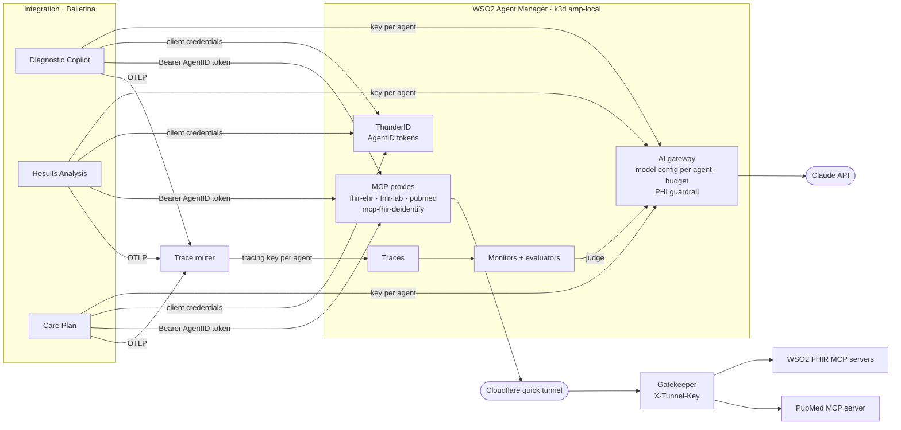

# Governing the EHR + Lab agents with WSO2 Agent Manager

How this demo puts three Claude agents, hosted in a Ballerina integration, under WSO2 Agent Manager (AMP)
1.0.0: **agent identity** and **role-based tool permissions**, **FHIR-aware de-identification** of MCP tool
results (a custom gateway policy), the **AI gateway** with a **PHI guardrail** and **per-agent budgets**,
**cost** and **traces** for every agent run, and **evaluation** with built-in and custom evaluators. Everything here is
scripted, so you can reproduce it on a laptop and reuse the pattern for any externally hosted agent.

## What you get

| Feature | What it does here | AMP mechanism | In this repo |
|---|---|---|---|
| Agent identity | Each agent has its own OAuth client (AgentID) | AgentID per external agent (environment ThunderID) | `scripts/amp-setup.sh` |
| Permissions | Roles decide which MCP tools an agent may call: the Copilot and Analyst read the EHR, all three search PubMed, nobody writes | MCP proxies with identity security, scopes per tool group, roles assigned to agents | `amp-setup.sh`, `agents.bal` (`connectMcp`) |
| FHIR de-identification | Names, addresses, contact details and identifiers are taken out of FHIR tool results before an agent (and Claude) sees them; guarded searches are refused | Custom gateway policy `mcp-fhir-deidentify` on the FHIR MCP proxies | `gateway/policies/mcp-fhir-deidentify`, `scripts/amp-gateway.sh`, `amp/fhir-deidentify.json` |
| AI gateway | Agents call Claude through AMP, each through its own model configuration and key; the Anthropic key lives only in AMP | LLM provider (`anthropic` template) + an agent model configuration (LLM proxy) per agent | `amp-setup.sh`, `model_provider.bal` |
| Budgets and cost | Each agent has its own US$/day and tokens/hour budget; over budget the gateway refuses it and the workflow waits for operations. Spend per agent, assessment and workflow step in the portal | `llm-cost`, `llm-cost-based-ratelimit`, `token-based-ratelimit` on each agent's model configuration | `scripts/amp-budgets.sh`, `amp/budgets.json`, `infra/trace-router` (ledger) |
| PHI guardrail | MRNs, SSNs and phone numbers are redacted before anything reaches Claude | `pii-masking-regex` policy on the provider | `scripts/amp-guardrails.sh` |
| Monitoring | Every agent run is a trace under its agent: LLM calls, tool calls, tokens, latency | OTLP traces with GenAI semantic conventions | `ballerina/otel`, `infra/trace-router` |
| Evaluation | Each agent is scored continuously by built-in and custom evaluators, judged by Claude | Evaluators + monitors (Argo workflows in AMP) | `amp/`, `scripts/amp-evaluations.sh` |

## Architecture



## Set it up

```bash
./scripts/up.sh                  # colima VM + demo stack (first run restores seed/snapshot)
./scripts/amp-install.sh         # AMP 1.0.0 as k3d cluster amp-local (~15–20 min, once)
./scripts/amp-gateway.sh         # custom gateway: stock 1.2.1 policies + mcp-fhir-deidentify (~6 min first time)
./scripts/amp-setup.sh           # agents, AgentIDs, roles, MCP proxies (+ tunnel, FHIR policy),
                                 # model configs, keys and budgets per agent, tracing keys
./scripts/amp-guardrails.sh --verify   # PHI guardrail, and proof of what Claude receives
./scripts/amp-evaluations.sh --backfill 24   # custom evaluators, a monitor per agent, review of the last 24 h
```

Console: http://console.amp.localhost:8080 (admin / admin) → project **Longevity Clinic**. The portal
does not show governance; demo it from the console and the scripts. Every script is idempotent; keys and secrets are rotated on each run and
written to gitignored files (`secrets.toml`, `.amp/`), never printed.

## 1. Agent identity and permissions

Registering an agent as **externally hosted** (`provisioning.type: external`) gives it an **AgentID**: an
OAuth client in the environment's identity provider. AgentID becomes useful when tools sit behind **MCP
proxies** with identity security. A proxy groups its tools into **scopes** (`<proxy>:<action>`); **roles**
carry scopes; agents get roles. When an agent requests a token, the identity provider grants only the scopes
its roles carry, and the gateway refuses any tool call the token does not cover.

| Proxy | Scope | Tools |
|---|---|---|
| `fhir-ehr` (the EHR), `fhir-lab` (the lab's FHIR server) | `read` | `get_capabilities`, `search`, `read` |
| | `write` | `create`, `update`, `delete` |
| `pubmed` | `search` | `search_pubmed`, `get_abstract` |

| Role | Scopes | Agents |
|---|---|---|
| `ehr-reader` | `fhir-ehr:read` | Diagnostic Copilot, Results Analysis |
| `lab-reader` | `fhir-lab:read` | Results Analysis |
| `literature-searcher` | `pubmed:search` | all three |
| `ehr-writer` | `fhir-ehr:write`, `fhir-lab:write` | none: the EHR and the lab change only through workflow activities |

Every tool must sit under some scope, because AMP lets any authenticated agent call a tool no scope covers.
That is why the write tools have a scope even though nobody holds it.

Both FHIR MCP servers offer the same tool names, so the integration publishes each server's tools to the agent
under a prefix (`ehr_search`, `lab_search`… — `mcp_toolkit.bal`) and calls the server with the tool's own name.
The proxy therefore sees `search` and `read` as usual, and the scopes above apply unchanged.

In Ballerina, the agent's MCP connection authenticates with its AgentID. `ai:McpToolKit` accepts an
`http:ClientAuthConfig`, so token fetch and refresh are handled for you:

```ballerina
ai:McpToolKit toolkit = check new (proxyUrl, permittedTools, auth = {
    tokenUrl: agentManager.tokenUrl,            // http://default-idp.amp.localhost:8080/oauth2/token
    clientId: agent.clientId,
    clientSecret: agent.clientSecret,
    scopes: agent.mcpScopes[target] ?: [],      // e.g. ["fhir-ehr:read"]
    optionalParams: {"resource": proxyUrl}      // RFC 8707: one token per proxy
});
```

**Demoing it.** The portal's **Agent Manager** page asks AMP live: for each agent and permission it requests
the agent's token and shows what was granted, and **Try** makes a real, harmless MCP call as the agent
through the proxy (`get_capabilities`, a one-result PubMed search). The Care Plan agent's EHR column says
*Not granted*, and its Try is *Refused by Agent Manager*. Then, in the console (environment roles), assign
`ehr-reader` to the Care Plan agent, press **Re-check**, and the column turns green. Re-running
`amp-setup.sh` restores the intended assignments.

## 2. FHIR de-identification on the MCP proxies (`mcp-fhir-deidentify`)

The WSO2 FHIR MCP server returns whole FHIR resources. Without a control at the gateway, what an agent sees
is decided by the model (`response_filter_fhirpaths` is optional, so the model can leave it out) or by each
MCP server. `mcp-fhir-deidentify` is a response-flow gateway policy that applies operator rules per resource
type to every FHIR resource in a `tools/call` or `resources/read` result — in `content[].text`, embedded
resources and `structuredContent`, JSON or event-stream responses, Bundle entries, `_include`d and contained
resources — before the agent sees it. It is written in Go against the API Platform SDK, like the stock
policies, so it can be contributed to `wso2/gateway-controllers` as is.

| Option (per resource type) | Effect |
|---|---|
| `rules` | `fhirPaths` + `operation`: `redact`, `mask` (keep last `keepLast`), `hash` (HMAC-SHA256 pseudonym, key from gateway config), `generalize` (dates to `year`/`month`) |
| `include` | Allowlist: only these elements (plus `resourceType`, `id`, `meta`). Choice elements match every type (`Observation.value` keeps `valueQuantity`) |
| `access: deny` | Never returned: a Bundle entry is removed; a direct read becomes an error result |
| `denySearchParams` | Request side: refuses tool calls searching on guarded fields, including modifiers (`family:exact`), chains (`subject:Patient.name`, `patient.family`), reverse chains (`_has:`), and `_text`/`_content`/`_filter` |

Policy-wide: narrative `text` and `Reference.display` removed by default; changed resources tagged in
`meta.security` (v3-ObservationValue `REDACTED`, `MASKED`, `PSEUDED`, `ABSTRED`); `defaultAccess` for types not
listed; `nonJsonContent` (allow or block text a FHIR parser cannot inspect). **Fails closed**: a result that
looks like JSON but does not parse, or any processing error, becomes an `isError` tool result — never the raw
data. Paths use a FHIRPath subset compiled when the policy is deployed: `Type.a.b`, `where(x = 'v' and|or …)`,
`!=`, `.exists()`, `extension('url')`, `ofType(T)`, `first()`, `[n]`.

The demo's rules (`amp/fhir-deidentify.json`) are "minimum necessary" for these agents, live through the EHR's
proxy as the Copilot:

| Element | FHIR server | Agent sees |
|---|---|---|
| `Patient.name` | Crystal Schmeler | removed |
| `Patient.telecom` (phone) | 555-291-4926 | `********4926` |
| `Patient.birthDate` | 1971-10-12 | `1971` |
| `Patient.identifier.value` | MRN-201485 | `h_6d1c1cc9c96d5b31` |
| `Patient.address` | 877 Ankunding Run, Boston 02199, lat/long extension | `{state: MA, country: US}` |
| `Observation` | + `note`, `performer`, `issued` | clinical elements only (allowlist) |
| `DocumentReference`, `Communication`, `Claim`, … | notes, messages, billing | withheld |
| `search Patient family=Schmeler` | the patient | refused before the EHR |

**How it gets into AMP.** Gateway policies are compiled into the gateway. `scripts/amp-gateway.sh`:
1. runs the policy's tests, plus a check of `amp/fhir-deidentify.json` against it;
2. builds the gateway with WSO2's `gateway-builder:1.2.1` from `gateway/build.yaml` — every stock policy pinned
   to the version 1.2.1 ships, plus this one — into two images (runtime with the policy compiled in, controller
   with its definition);
3. imports them into the k3d cluster and points the gateway's Helm values at them, with the hash key and the
   controller's definitions path (`ISSUES_TO_REPORT.md` D10);
4. waits until AMP offers the policy for MCP proxies. `amp-setup.sh` then attaches it to `fhir-ehr` and
   `fhir-lab` (`--no-fhir-policy` for a before/after). `--restore` returns to the stock gateway.

**Review of the proposal.** The design holds up; what building it showed:
- **Choice types must be explicit.** `Observation.value` in an allowlist has to match `valueQuantity`,
  `valueString`, …; otherwise the allowlist drops every value. The implementation follows FHIRPath here.
- **Address needs more than `line`.** Redacting `line` leaves city, postal code and the geolocation extension
  (lat/long) — all identifying under HIPAA Safe Harbor. The demo redacts them; the example config should too.
- **This is minimum necessary, not Safe Harbor.** Safe Harbor removes all dates but the year, including
  observation dates — which would destroy the trends these agents reason about. The policy should be presented
  as "minimum necessary" de-identification; date shifting (a stable per-patient offset) is the natural v2
  operation for full de-identification that keeps intervals.
- **Allowlists must keep `id`, `meta` and references** so agents can still navigate (`Observation.subject`).
- **Searches leak through chains.** `denySearchParams` alone misses `Observation?patient.family=Doe` and
  `_has:`; the implementation checks modifiers, chains, reverse chains and free-text parameters.
- **Hashed identifiers break lookups by identifier**, which is the point; agents work by FHIR resource id.
- **Free text inside allowed elements** (e.g. `Condition.note`, `DiagnosticReport.conclusion`) still needs rules
  or NLP scrubbing (out of scope for v1, as proposed).
- **Per-scope profiles** fit AMP naturally: MCP policies carry an `executionCondition`, so a v2 can apply
  different rules per AgentID role.
- **It covers MCP only.** Data the application puts into a prompt itself (the Copilot's selected records) does
  not pass the MCP proxy; the AI gateway's PHI guardrail is the control there.

## 3. AI gateway, per-agent budgets and the PHI guardrail

The `anthropic` LLM provider holds the Anthropic key and is deployed to the environment's gateway. Each agent
has its own **model configuration** (`claude`, on the agent's page in the console): an LLM proxy over the
provider with its own URL, key and policies. It inherits the provider's guardrails, and its own policies are
the agent's budget. The Ballerina Anthropic connector only needs a different base URL and key per agent:

```ballerina
new anthropic:ModelProvider(agent.llmApiKey, modelName,
        serviceUrl = agent.llmGatewayUrl, ...)   // http://default-default.gateway.localhost:19080/claude-…/v1
```

The provider has `security.apiKey.key = "x-api-key"` (the connector always sends it) and
`resilience.timeout = "300s"`. The per-agent proxies are created with an `API-Key` header and a 60 s timeout;
`amp-budgets.sh` switches them to `x-api-key` and 300 s (`ISSUES_TO_REPORT.md` D9, D12).

**Budgets** (`amp/budgets.json`, applied by `scripts/amp-budgets.sh`): per agent, `llm-cost-based-ratelimit`
(US$ per day, priced by `llm-cost` from the gateway's price list — Sonnet 4.6 at $3/$15 per M tokens) and
`token-based-ratelimit` (tokens per hour). Why model configurations and not consumer-level limits on the
provider: those key on an application id that provider API keys do not carry, so all agents would share one
bucket (D11). Over budget the gateway answers `429 llm_cost_quota`; agent workflow steps retry twice, then
raise a review — operations raise the budget and press **Retry**, and the assessment continues.

**Cost.** AMP's console shows tokens per trace but not money. The trace router keeps a ledger of every agent
run (tokens from its `chat` spans, the assessment from `gen_ai.conversation.id`), priced with the same gateway
price list, at `GET /api/agent-manager/usage` (spend per agent, recent runs, the AI cost of an assessment).

**PHI guardrail.** `amp-guardrails.sh` adds `pii-masking-regex` to the provider with `redactPII: true`, applied
to the whole request body (`jsonPath: ""`), so the conversation history and the FHIR data in tool results are
covered, not just the last message. Claude never sees the identifiers, so it can't repeat them in a note or a
patient report. Agents address the EHR by FHIR resource id (`Patient/p-…`), which is not PHI. `--verify` shows
it:

```
Sent:   MRN-100234 · SSN 123-45-6789 · 617-555-0142
Claude repeats what it received:
  *****
  *****
  *****
```

`--remove` takes the guardrail off again, for a before/after demo.

Choices and limits, learned the hard way:
- **Redact, not mask-and-restore.** The policy can also swap identifiers for placeholders (`[MRN_0000]`) and
  restore them in the reply. But Claude sometimes reformats a placeholder (`MRN_0001` without brackets), and
  then the "restored" tool argument is wrong.
- **Patterns must start at a word boundary with a digit or an uppercase letter.** The policy runs its
  regexes over the raw JSON text. The built-in email pattern matched from inside a `\n` escape in a PubMed
  abstract and left an invalid `\*****` in the body, and Anthropic rejected the request
  (`ISSUES_TO_REPORT.md` D6). Hence no email masking here.
- **Names and addresses** need an NER guardrail. The gateway ships `aws-bedrock-guardrail` and
  `azure-content-safety` policies for that.
- **Traces are recorded agent-side**, so the traces in AMP still contain PHI. Protect the console
  accordingly.

### Cheaper models through OpenRouter

The agents can also run on **DeepSeek V4.1 Flash** (`deepseek/deepseek-v4.1-flash`, $0.047 / $0.12 per M tokens
in / out against Claude Sonnet 4.6's $3 / $15), through the same AI gateway. Nothing about the Anthropic setup
changes: OpenRouter is added next to it, and one command switches the agents between the two.

```bash
# secrets.toml: openrouterApiKey = "sk-or-v1-…"
./scripts/amp-openrouter.sh            # provider + PHI guardrail, per-agent "openrouter" model configs, budgets, prices
./scripts/amp-models.sh openrouter     # point the agents at them (back: ./scripts/amp-models.sh claude)
```

- **Provider `openrouter`:** OpenAI template, upstream `https://openrouter.ai/api/v1`; holds the OpenRouter key and
  carries the same `pii-masking-regex` guardrail as `anthropic`.
- **Model configuration `openrouter` per agent:** its own LLM proxy, key and budget, beside the agent's `claude`
  configuration. `amp-models.sh` issues the agent a key for the chosen one, writes it and the gateway URL into
  `secrets.toml`, sets `modelProvider` in `config/integration.toml` and restarts the integration.
- **Prices:** the gateway's price list has neither model, so `amp-openrouter.sh` adds both from OpenRouter's
  catalogue (under the name OpenRouter answers with). `llm-cost` then prices the calls, and the dollar budgets and
  the portal's spend work as for Claude.
- **The integration** uses Ballerina's `ai.openrouter` provider (`modelProvider = "openrouter"`).

Measured on one full assessment (Copilot, Results Analysis, Care Plan): **$0.0072** in all, about 112k tokens.

Getting OpenRouter through Agent Manager 1.0.0 needed three workarounds:
- **Bearer keys.** The OpenAI-style client can only send `Authorization: Bearer <key>`, and Agent Manager drops the
  gateway's `valuePrefix` option that would strip `Bearer ` (`ISSUES_TO_REPORT.md` D14). `infra/llm-auth-adapter`,
  a small Python service, moves the key to `x-api-key` on the way to the gateway (and drops JSON null fields some
  providers reject), so the OpenRouter proxies check
  keys exactly as the Claude ones do.
- **The provider checks `x-api-key`.** Each proxy calls its provider with an internal key in a header fixed when
  the proxy is created, and `Authorization` does not work for that hop (D16). The provider's upstream auth to
  OpenRouter is still `Authorization: Bearer <OpenRouter key>`.
- **Fresh key names.** The gateway drops a re-issued key whose name it already holds (D15), so `amp-models.sh`
  revokes an agent's old keys and issues a new one under a timestamped name.

DeepSeek sometimes answers a structured-output request in plain text instead of the tool call the Ballerina
provider asks for ("did not return a tool call"). The workflow's agent retries absorb it.

**Other models.** `./scripts/amp-models.sh openrouter --model <id>` switches to any OpenRouter model (its price is
added to the gateway first). One assessment each (Sofia Alvarez, same question, all tools), judged by GPT-6 Luna
(`./scripts/amp-scores.sh deepseek-v4-1-flash glm-5-3 claude-haiku-5-5`):

| | DeepSeek V4.1 Flash | GLM 5.3 | Claude Haiku 5.5 |
|---|---|---|---|
| Whole journey, first try | yes | yes, with `maxTokens = 32768` | no: one tool loop; proposed no orderable tests |
| Cost per assessment | $0.018 | $0.111 | $0.033 |
| Agent time | ~2.5 min | ~6.5 min | ~2 min |
| Copilot: helpfulness / instruction following | 0.75 / 0.65 | 0.75 / 0.92 | 0.87 / 0.25 |
| Analysis: completeness / reasoning / clinical grounding | 0.90 / 0.70 / 0.75 | 0.98 / 0.70 / 0 | 1 / 0.82 / 1 |
| Care plan: clarity / tone / medication safety | 0.86 / 0.66 / 0.75 | 0.75 / 0.56 / 0.75 | 0.90 / 0.73 / 1 |
| Code checks (PHI, read-only, orderable tests, citations) | all pass | all pass | orderable tests 0; no citations |

One run each, so read it as an indication. The demo uses DeepSeek: the only model that completed every step first
time with its tools, at the lowest cost. GLM 5.3 reasons at length (raise `maxTokens`; 8192 cut it off). Mistral
Large 4 rejects the client's `"strict": null` tool field (422); `infra/llm-auth-adapter` now drops null fields, but
it was not re-tested.

## 4. Monitoring

`ballerina/ai` 1.15+ emits GenAI spans for every agent run (`invoke_agent`, `chat`, `execute_tool`).
`ballerina/otel` exports them over OTLP/HTTP:

```toml
[ballerina.observe]
tracingEnabled = true
tracingProvider = "otel"

[ballerina.otel]
tracesProtocol = "http/protobuf"
tracesEndpoint = "http://trace-router:4318/v1/traces"
```

AMP files a trace under an agent by the API key it arrives with (`x-amp-api-key`), but one process hosts
three agents and has one exporter. `infra/trace-router` (about 200 lines of Python) does three things:
- **Routes each run:** it sends each agent run with that agent's tracing key, chosen by
  `gen_ai.agent.name` on the `invoke_agent` span.
- **Drops non-agent traffic:** pollers, portal reads and startup spans are not forwarded.
- **Normalises agent spans** for AMP's trace model: it moves the agent's input and output from
  `gen_ai.*.messages` (a plain string or JSON object in Ballerina) to `traceloop.entity.input`/`output`,
  which is where AMP's evaluators read them (D8). Without this, evaluators see an empty input and output
  and skip the trace.
- **Forwards only the agent's subtree:** the `invoke_agent` span becomes the trace root, so AMP shows the
  run's input and output on the trace list.

`ballerinax/amp` is the native alternative when a process hosts one agent. In 2201.14.1 its bundled
OpenTelemetry jars (1.14) clash with the runtime's (1.65), which is another reason to use `ballerina/otel`.

## 5. Evaluation

A **monitor** runs a set of **evaluators** over an agent's traces: continuously (`type: future`, every N
minutes) or once over a past window (`type: past`). LLM-judge evaluators use a model through an AMP LLM
provider (`llmProvider: {providerName: "openrouter-judge"}` with `model: "openai/gpt-6-luna"`, or
`claude-judge` with `claude-sonnet-4-6`).
Results appear on the monitor dashboard and in a **Score** column on each trace.

**The judge's provider.** In AMP 1.0.0 none of the direct routes works for a Claude judge:
- **Anthropic-template provider:** the evaluation image's Anthropic SDK rejects the `temperature` argument
  the judge always sends (`ISSUES_TO_REPORT.md` D7).
- **Anthropic's OpenAI-compatible API:** it rejects the judge's `response_format` schema, which uses
  `minimum`/`maximum`.
- **The gateway's `openai-to-anthropic-transformer`:** in gateway 1.2.1 it translates the request but not
  the reply.

**Judge profiles.** `amp/monitors.json` names the judge (`"judge"`), and `amp-evaluations.sh` creates that
profile's provider and points every monitor at it (`--judge claude` overrides it for one run):
- **`openrouter` (the default):** GPT-6 Luna (`openai/gpt-6-luna`, $0.10 / $0.50 per M tokens) through the
  `openrouter-judge` provider: OpenAI template, upstream OpenRouter. It accepts the judge's `response_format` as
  sent, so it needs no adapter. GPT-6 Luna reasons before it answers, so the profile raises the judges' output
  cap (`maxTokens: 8192`; the default 1024 ran out on large traces). A review of one full assessment's traces cost
  about $0.05.
- **Reviews per model:** `--since <time> --until <time> --label <name>` reviews one window as `<agent>-review-<name>`,
  kept beside other labelled reviews; `./scripts/amp-scores.sh <name>…` prints them side by side. A new review's
  first run can miss its judge proxy (401, judges skipped; `ISSUES_TO_REPORT.md` D17): `--rerun <name>` repeats it.
- **`claude`:** Claude Sonnet 4.6 through `claude-judge`, which needs the workarounds below.

`amp-evaluations.sh` creates `claude-judge` with three parts:
- **Template:** OpenAI, so the judge uses its working OpenAI client.
- **Upstream:** Anthropic's OpenAI-compatible API.
- **Policy:** `interceptor-service`, calling `infra/judge-adapter` (about 40 lines of Python), which removes
  `response_format` from the request. The judge's prompt already asks for the same JSON, and the judge
  validates the reply itself.

It's the same Claude model, and it's separate from the agents' provider, so judge traffic neither uses the
agents' keys nor passes the PHI guardrail.

`amp/monitors.json` configures one monitor per agent, mixing built-ins with custom evaluators:

| Agent | Built-in | Custom |
|---|---|---|
| Diagnostic Copilot | helpfulness, instruction_following, iteration_efficiency, latency_performance | orderable tests only, citation integrity, PHI leak, EHR read-only |
| Results Analysis | completeness, reasoning_quality, step_success_rate | clinical grounding, citation integrity, PHI leak, EHR read-only |
| Care Plan | clarity, tone (patient context), safety, length_compliance | medication safety, citation integrity, PHI leak |

The custom evaluators are in `amp/evaluators/` and described in `evaluators.json`:

| Evaluator | Type · level | Checks |
|---|---|---|
| `phi-leak-check` | code · trace | No MRN, SSN, phone or email in the agent's output |
| `pubmed-citation-integrity` | code · agent | Every cited PMID was retrieved by a PubMed tool call in the same run |
| `catalog-tests-only` | code · trace | The Copilot proposes only tests the lab offers |
| `ehr-read-only` | code · agent | No FHIR write tool was attempted |
| `medication-safety-in-patient-report` | LLM judge · trace | The patient report never tells the patient to change a medication |
| `clinical-grounding` | LLM judge · agent | Every value, trend and diagnosis in the analysis is traceable to the input or a tool result |

Writing a code evaluator:
- Write a plain Python function whose first parameter's type (`Trace`, `AgentTrace` or `LLMSpan`) sets the
  level, and return `EvalResult(score=0..1, passed=…, explanation=…)`, or `EvalResult.skip(reason)` when it
  doesn't apply.
- Declare every configurable parameter with `Param(...)`. Plain keyword defaults are not recognised, and the
  monitor fails with "Unknown config parameter".

```python
from amp_evaluation import EvalResult, Param
from amp_evaluation.trace.models import Trace

def catalog_tests_only(trace: Trace,
                       allowed_codes: list = Param(default=[], description="Test codes in the lab catalog")) -> EvalResult:
    ...
```

The sandbox blocks network and OS modules (`os`, `subprocess`, `requests`, …), and stdlib, numpy and pandas
are available. An LLM-judge evaluator is a prompt template with `{trace.output}`-style expressions and a
0–1 rubric; AMP appends the output-format instructions itself.

## 6. A ten-minute demo

1. **Identity** (console → project → agents): three AgentIDs and their roles — `ehr-reader` on the Copilot
   and Results Analysis, `lab-reader` on Results Analysis only, no EHR or lab access for Care Plan.
2. **FHIR de-identification** (console → MCP proxies → fhir-ehr → policies: `mcp-fhir-deidentify`). For
   proof, `./scripts/amp-setup.sh --no-fhir-policy` and back.
3. **Run an assessment** (portal home → Physician workspace → Sofia Alvarez → order labs; release results from
   the lab console). The Results Analysis agent reads the EHR through the FHIR MCP proxy and cites PubMed.
4. **Govern the spend** (console → agent → model configuration). `./scripts/amp-budgets.sh --exhaust care-planner`,
   release the lab results: the Care Plan step retries, then the assessment pauses with "Daily AI budget
   reached" and **Retry / Stop**. `./scripts/amp-budgets.sh` to restore, press **Retry**: the workflow completes.
5. **Traces** (console → Diagnostic Copilot → Traces): the run with its LLM calls, `search`/`read` and
   `search_pubmed` tool calls, tokens and duration.
6. **Guardrail:** `./scripts/amp-guardrails.sh --verify` — the model can only repeat `*****` for the MRN, SSN and
   phone number it was sent.
7. **Evaluation** (console → agent → Monitors): scores per evaluator over time. Open a trace to see its
   per-evaluator scores and explanations. `./scripts/amp-scores.sh` prints the same in the terminal.

## Notes for a real deployment

- **MCP upstreams must be public.** AMP 1.0.0 refuses MCP-proxy upstreams that resolve to private
  addresses, with no allowlist (`ISSUES_TO_REPORT.md` D3). The demo reaches its local MCP servers through a
  Cloudflare **quick tunnel**. Quick tunnels are free and need no account, but they have no SLA, a random
  URL per start and a ~200 in-flight request cap. The gatekeeper makes the public URL useless without the
  key AMP's proxy sends. In production, publish the MCP servers properly (or run them where AMP can reach
  them) and keep the proxy's upstream key.
- **Gateway timeout.** The gateway route is capped at 30 s regardless of the provider's timeout (D4).
  `amp-setup.sh` raises it to 300 s.
- **Installer.** On macOS, use the quick-start container rather than the host installer (D1, D2).
- **Custom gateway.** The demo swaps AMP's gateway images in place; in production, publish the custom images to
  a registry and set them in the gateway's Helm values, and keep the hash key in a Secret rather than the
  values ConfigMap. An AMP upgrade resets the values: re-run `amp-gateway.sh`.
- **Quick tunnel URLs lapse.** `amp-setup.sh` recreates the tunnel when its URL stops answering and repoints
  the proxies.
- **Ballerina.** File names can matter to the isolation checker in 2201.14.1 (B12).
